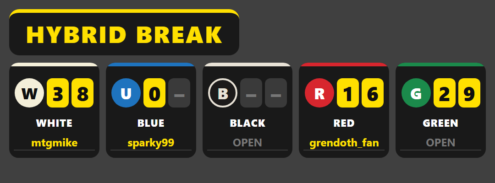

# Whatnot break overlays for OBS

Stream overlays for running Magic: The Gathering breaks on Whatnot.

## Hybrid break board

A hybrid break has 5 slots. Each slot is one color (White, Blue, Black, Red, Green) plus 2 digits that the host assigns. The board shows viewers which color and digits each buyer owns.



- `breakboard/server.py` is a small local server with no dependencies beyond Python 3.
- `breakboard/control.html` is the control panel, run as an OBS dock. You type buyer names and digits here, and the overlay updates as you type. If a digit is assigned twice, it's flagged in red.
- `breakboard/overlay.html` is the on-stream board, run as an OBS browser source. It scales to the source's width.

### Setup

1. Start the server before going live:

   ```
   python breakboard/server.py
   ```

2. Add the control panel as a dock. In OBS, open **Docks → Custom Browser Docks**, then add `http://127.0.0.1:8765/control`.
3. Add the overlay to your scene. Add a **Browser** source with **Local file** unticked, set the URL to `http://127.0.0.1:8765/overlay`, and size it 1080 × 400.

### Running a break

- Type each buyer's name next to their color, then their two digits. After you type a digit, the cursor jumps to the next digit box, so all ten can be entered in one go.
- **New break** clears all names and digits.
- **Hide overlay** takes the board off screen, and **Show overlay** brings it back.

The current break is saved to `breakboard/state.json`. If OBS or the server restarts mid-break, nothing is lost. The file is created automatically on first run, so a new computer doesn't need a copy of it.

### Troubleshooting

- **The control dock disappeared:** open the **Docks** menu and tick **Break Control** again. If it isn't listed, re-add it under **Docks → Custom Browser Docks**.
- **The overlay is blank:** make sure the server is running, then open the source's **Properties** and click **Refresh cache of current page**.
- **The board looks small or has empty space below it:** set the browser source to 1080 × 400. A new browser source defaults to 800 × 600, and the board shrinks to fit that width.
- **The dock says "offline":** the server isn't running. Start it with `python breakboard/server.py`.

## Color break tiles

`assets/` has static SVG tiles for an 8-color break (W/U/B/R/G/Multi/Colorless/Lands). To regenerate them from one template, run:

```
python tools/build_assets.py
```
